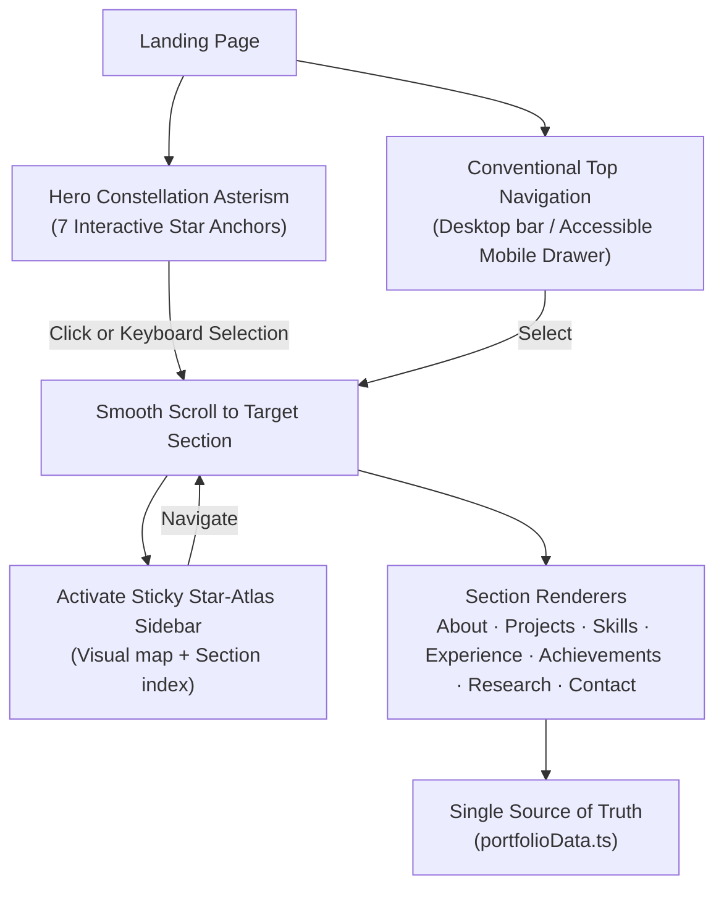
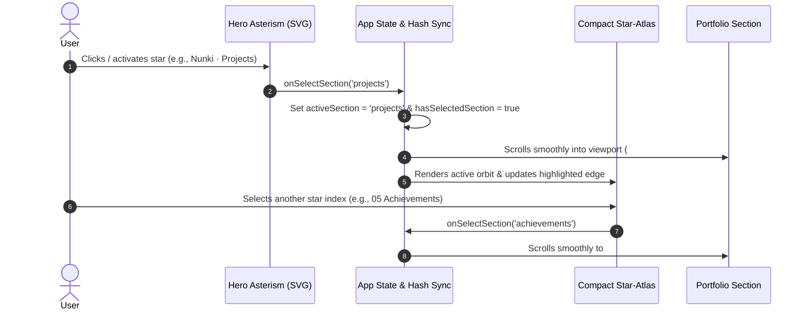

<div align="center">

# Anamta Karim ♐

### An interactive, celestial portfolio guided by the Sagittarius constellation — built with React 19, TypeScript, and Vite.


[🌐 **Visit Live Site**](https://anamta-karim.vercel.app)  ·  [The 7 Sections](#the-7-sections)  ·  [Architecture](#architecture--how-it-works)  ·  [Tech Stack](#tech-stack)

</div>

---

## About This Project

I built this website to bring together my projects, research, and technical journey in one interactive space. Rather than a standard list of links and resumes, I wanted visitors to explore my professional life through a celestial lens—anchored by the Sagittarius constellation (my sun sign) as an artistic and visual guide across each chapter of my learning and engineering.

---

## Table of contents
- [About This Project](#about-this-project)
- [The 7 Sections](#the-7-sections)
- [Architecture & How it works](#architecture--how-it-works)
- [Tech stack](#tech-stack)
- [Project structure](#project-structure)
- [Deployment](#deployment)

---

## The 7 Sections

The seven major stars of the Sagittarius asterism guide you through seven chapters of my work:

| Star & Number | Section | What's featured |
|---|---|---|
| **01 · Kaus Borealis** | **About Me** | Academic background at Jamia Hamdard University (CGPA 9.25/10), core philosophy, active research focus, and custom vector celestial arch artwork |
| **02 · Nunki** | **Featured Projects** | Flagship projects **SkinWise** (live skincare intelligence platform + demo video) and **PassOn** (hyper-local circular economy platform + live demo), plus research pipelines |
| **03 · Ascella** | **Technical Skills** | Grouped by engineering domain, separating daily core tools (Python, SQL, EDA, scikit-learn) from project-applied stacks (PyTorch, PEFT/LoRA, AWS Bedrock, Flask) |
| **04 · Kaus Australis** | **Experience & Leadership** | Practical data analytics training (Deloitte virtual simulation) and student leadership (Vice-President of Ignite Community, Joint Secretary at Aarambh’25) |
| **05 · Arkab** | **Achievements & Programs** | Technical training milestones (ISRO/IIRS Geodata, McKinsey Forward, Google Cloud Agentic AI, CodeWithHarry), Reliance Foundation Scholar, SIH 2025, and direct certificate links |
| **06 · Rukbat** | **Research & Learning** | Ongoing LoRA-adapted Vision-Language Model pipeline for retinal clinical report generation under a 4GB GPU budget, plus applied engineering notes |
| **07 · Alnasl** | **Contact** | Direct contact channels (Email, GitHub, LinkedIn) and curriculum vitae request modal |

---

## Architecture & How it works



### Dual-mode navigation lifecycle



---

## Tech stack

| Layer | Technology | Rationale |
|---|---|---|
| **Framework** | React 19 + TypeScript 5.7 | Modern component architecture, strict type checking, and zero runtime overhead |
| **Bundler** | Vite 6.2 | Sub-second HMR during development and optimized static asset chunking |
| **Styling** | Vanilla CSS Variables (`src/index.css`) | Zero extra CSS runtime, custom metallic ice-blue and cosmic-violet design tokens |
| **Icons** | `lucide-react` | Clean, accessible SVG iconography |
| **Testing** | Vitest 3.0 + Testing Library | Fast, lightweight integration and unit test suite |
| **Analytics** | `@vercel/analytics` | Privacy-friendly, cookieless traffic telemetry |
| **Hosting** | Vercel Edge Network | Global CDN caching with instant automated git deployments |

---

## Project structure

```text
Portfolio-Website/
├── public/
│   ├── certificates/          # Official certification documents (.png, .pdf)
│   ├── projects/              # Full-resolution project screenshots
│   ├── favicon.svg            # Custom celestial 4-point star favicon
│   ├── og-preview.svg         # OpenGraph social share card
│   └── resume.pdf             # Curriculum vitae asset
├── src/
│   ├── assets/
│   │   └── projects/          # Bundled project screenshot modules
│   ├── components/
│   │   ├── BrandIcons.tsx     # Custom SVG brand marks (GitHub, LinkedIn)
│   │   ├── CelestialBackdrop.tsx # 100% Vector SVG digital-art night sky
│   │   ├── ConstellationHero.tsx # Interactive Sagittarius asterism & observatory
│   │   ├── ConstellationNavigator.tsx # Dual top-nav & compact sticky star atlas
│   │   ├── PortfolioSections.tsx # 7 core sections (About to Contact) & footer
│   │   ├── ProjectCard.tsx    # Technical case studies & screenshot fallbacks
│   │   └── ResumeButton.tsx   # Verified PDF opener & accessible fallback dialog
│   ├── data/
│   │   └── portfolioData.ts   # Single source of truth for all profile content
│   ├── test/
│   │   ├── App.test.tsx       # 8 Vitest integration & accessibility tests
│   │   └── setup.ts          # Test environment setup & matchers
│   ├── types/
│   │   └── portfolio.ts       # TypeScript domain models
│   ├── App.tsx                # App shell, scroll observer, and analytics
│   ├── index.css              # Custom styling, animations & responsive system
│   └── main.tsx               # React 19 root entry
├── eslint.config.js
├── index.html
├── package.json
├── tsconfig.json
└── vite.config.ts
```

---

## Deployment

This site is deployed continuously on **Vercel**:

- **Production URL:** [https://anamta-karim.vercel.app](https://anamta-karim.vercel.app)
- **Build Command:** `npm run build`
- **Output Directory:** `dist`
- **Automatic Deploys:** Every push to `main` triggers a production build in ~20 seconds.

---

<div align="center">

Crafted with curiosity and rigor by [**Anamta Karim**](https://github.com/anamta-karim) · ♐ *Sun in Sagittarius*

</div>
