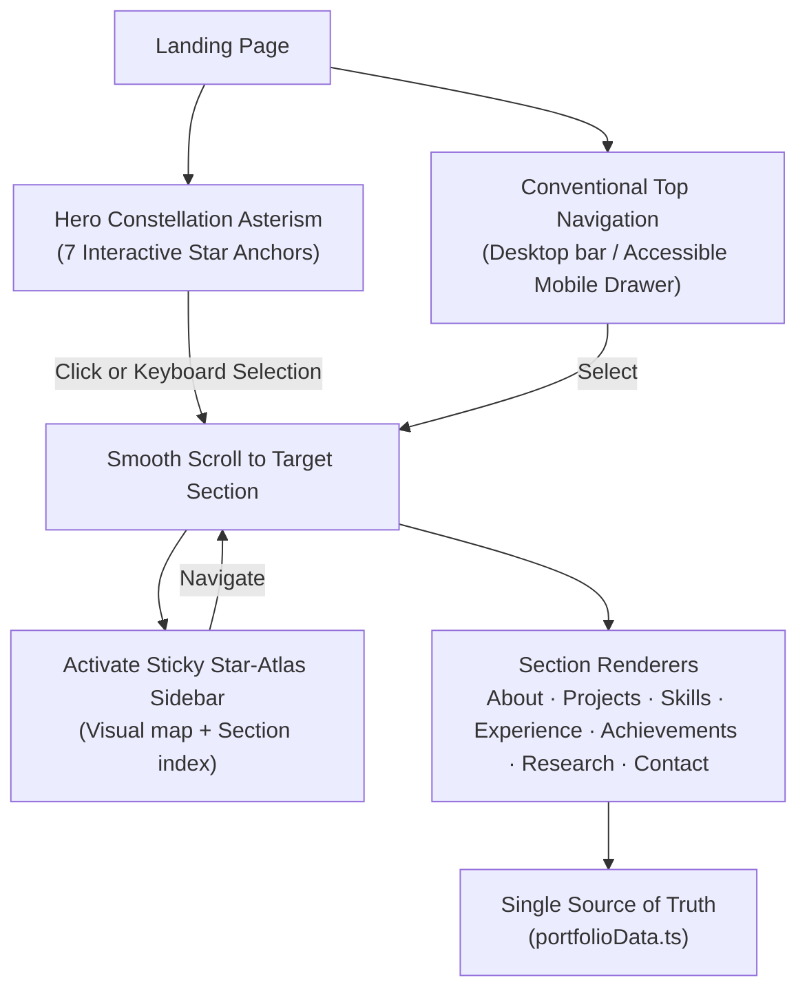
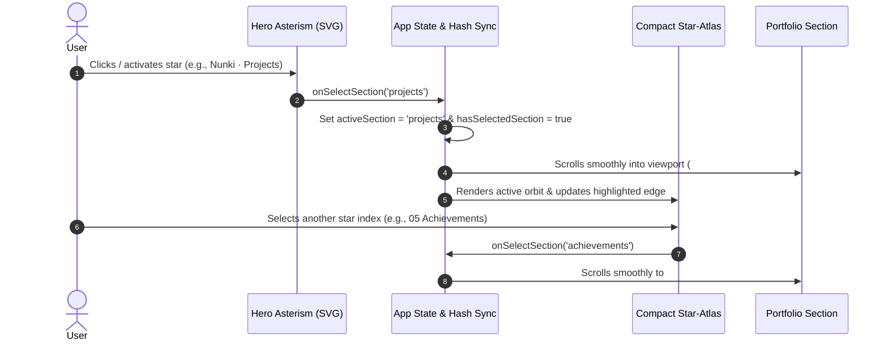

<div align="center">

# Anamta Karim ♐

### An interactive, celestial portfolio guided by the Sagittarius constellation — built with React 19, TypeScript, and Vite.


[🌐 **Visit Live Site**](https://anamta-karim.vercel.app)  ·  [The 7 Sections](#the-7-sections)  ·  [Architecture](#architecture)  ·  [Getting Started](#getting-started)

</div>

---

## In plain English

Most developer portfolios look identical: generic dark-mode templates, arbitrary skill progress bars, and fabricated metrics. 

This website is built differently. It combines real-world software engineering with an intentional **celestial digital-art aesthetic** inspired by the **Sagittarius constellation**:

1. **The landing experience** presents an interactive Sagittarius Star-Atlas observatory. Seven primary navigation stars map directly to the seven main sections of the portfolio.
2. **Dual-mode navigation:** Clicking any star glides smoothly to that section, while a compact sticky sidebar star-atlas activates on the left for continuous orientation. Conventional accessible top navigation and a mobile drawer remain available at all times.
3. **100% Vector SVG digital art:** No blurry raster galaxy backgrounds. The cosmic backdrop, sweeping nebula ribbons, diffraction flares, mountain silhouettes, and observatory arches are sharp, resolution-independent SVGs rendered natively in CSS and React.
4. **Honest by design:** Every project claim is grounded in evidence. SkinWise is clearly labeled as an informational screening aid rather than a medical tool; PassOn notes where public demo storage is mocked vs. its full serverless repository backend; in-progress research (~50%) and early concepts (~10%) are transparently marked.

> ♐ **Why Sagittarius?** The celestial motif is a quiet personal nod to my sun sign, woven into the site as an authentic artistic atlas.

---

## Table of contents
- [What this project demonstrates](#what-this-project-demonstrates)
- [The 7 Sections](#the-7-sections)
- [Architecture & How it works](#architecture--how-it-works)
- [Honest by design](#honest-by-design)
- [Tech stack](#tech-stack)
- [Getting started](#getting-started)
- [Project structure](#project-structure)
- [Engineering challenges & lessons learned](#engineering-challenges--lessons-learned)
- [Deployment](#deployment)

---

## What this project demonstrates

| Area | What was built |
|---|---|
| **Component Architecture** | Modular React 19 + TypeScript architecture with strict typing, clean props interfaces, and complete separation between data ([`src/data/portfolioData.ts`](./src/data/portfolioData.ts)) and UI |
| **Vector Celestial Art** | Infinite-resolution SVG digital art backdrop with metallic ice-blue (`#9EDCFF`) and cosmic-violet (`#C5A9FF`) nebula bands, diffraction flares, and starlight lake reflections |
| **Dual-Mode Navigation** | Interactive 7-star Sagittarius SVG asterism with hover/click ripple telemetry, backed by a compact sticky Star-Atlas sidebar and a mobile drawer |
| **Accessibility (a11y)** | Keyboard navigable (`Tab` + `Enter`), visible focus rings, ARIA landmark roles, semantic heading hierarchy, and zero reliance on hover-only interactions |
| **Resilient Asset Handling** | Real project screenshots bundled via Vite module assets, dynamic multi-extension certificate detector (`.pdf`, `.png`, `.jpg`), and an accessible fallback dialog for resume requests |
| **Content Integrity** | Accurate project completion percentages, verified evidence metrics (pytest unit checks), and honest caveats across every system |
| **Automated Testing** | 8 Vitest + React Testing Library integration tests verifying routing, keyboard escape, domain filtering, caveats, and accessible modal behavior |

---

## The 7 Sections

The seven major stars of the Sagittarius asterism guide you through seven chapters of my work:

| Star & Number | Section | What's featured |
|---|---|---|
| **01 · Kaus Borealis** | **About Me** | Academic background at Jamia Hamdard University (CGPA 9.25/10), core philosophy, active research focus, and custom vector celestial arch artwork |
| **02 · Nunki** | **Featured Projects** | Flagship projects **SkinWise** (live skincare intelligence platform + demo video) and **PassOn** (hyper-local circular economy platform + live demo), plus research pipelines |
| **03 · Ascella** | **Technical Skills** | Grouped by engineering domain, separating daily core tools (Python, SQL, EDA, scikit-learn) from project-applied stacks (PyTorch, PEFT/LoRA, AWS Bedrock, Flask) |
| **04 · Kaus Australis** | **Experience & Leadership** | Practical data analytics training (Deloitte virtual simulation) and student leadership (Vice-President of Ignite Community, Joint Secretary at Aarambh’25) |
| **05 · Arkab** | **Achievements & Programs** | Technical training milestones (ISRO/IIRS Geodata, McKinsey Forward, Google Cloud Agentic AI, CodeWithHarry), Reliance Foundation Scholar, SIH 2025, and direct certificate links |
| **06 · Rukbat** | **Research & Learning** | Ongoing LoRA-adapted Vision-Language Model pipeline for retinal clinical report generation under a 4GB GPU budget, plus applied engineering notes |
| **07 · Alnasl** | **Contact** | Direct contact channels (Email, GitHub, LinkedIn) and verifiable curriculum vitae request modal |

---

## Architecture & How it works



### Dual-mode navigation lifecycle



---

## Honest by design

A professional portfolio must be truthful. This project enforces strict content guardrails:

- **SkinWise:** Clearly presented as an informational screening aid, not a medical diagnostic tool. An ingredient list alone does not establish clinical safety or individual dermatological suitability.
- **PassOn:** Explicitly clarifies that while the frontend is deployed live on AWS Amplify, persistent database CRUD and authentication are mocked in the public demo so visitors can test workflows without modifying shared data.
- **Retinal VLM Pipeline:** Honestly marked as an in-progress research exploration (~50% complete) focused on quantization setup and PEFT/LoRA engineering, with no fabricated clinical metrics.
- **Financial Risk Engine:** Transparently labeled as an early-stage concept (~10% complete, currently on hold) rather than a completed flagship system.
- **Deloitte Simulation:** Accurately classified as a self-paced virtual job simulation on Forage, not employment.
- **Scholarships & Awards:** Reliance Foundation Undergraduate Scholar recognition is stated accurately without invented figures.

---

## Tech stack

| Layer | Technology | Rationale |
|---|---|---|
| **Framework** | React 19 + TypeScript 5.7 | Modern component architecture, strict type checking, and zero runtime overhead |
| **Bundler** | Vite 6.2 | Sub-second HMR during development and optimized static asset chunking |
| **Styling** | Vanilla CSS Variables (`src/index.css`) | Zero extra CSS runtime, custom metallic ice-blue and cosmic-violet design tokens |
| **Icons** | `lucide-react` | Clean, accessible SVG iconography |
| **Testing** | Vitest 3.0 + Testing Library | Fast, lightweight integration and unit test suite |
| **Analytics** | `@vercel/analytics` | Privacy-friendly, cookieless traffic telemetry |
| **Hosting** | Vercel Edge Network | Global CDN caching with instant automated git deployments |

---

## Getting started

### Prerequisites
- **Node.js:** `v20.x` or `v22.x`
- **npm:** `v10.x`+

```bash
# 1. Clone the repository
git clone https://github.com/anamta-karim/Portfolio-Website.git
cd Portfolio-Website

# 2. Install dependencies
npm install

# 3. Start local development server
npm run dev

# 4. Run unit and integration tests
npm run test

# 5. Run ESLint code quality checks
npm run lint

# 6. Build production bundle
npm run build

# 7. Preview production build locally
npm run preview
```

---

## Project structure

```text
Portfolio-Website/
├── public/
│   ├── certificates/          # Official certification documents (.png, .pdf)
│   ├── projects/              # Full-resolution project screenshots
│   ├── favicon.svg            # Custom celestial 4-point star favicon
│   ├── og-preview.svg         # OpenGraph social share card
│   └── resume.pdf             # Curriculum vitae asset
├── src/
│   ├── assets/
│   │   └── projects/          # Bundled project screenshot modules
│   ├── components/
│   │   ├── BrandIcons.tsx     # Custom SVG brand marks (GitHub, LinkedIn)
│   │   ├── CelestialBackdrop.tsx # 100% Vector SVG digital-art night sky
│   │   ├── ConstellationHero.tsx # Interactive Sagittarius asterism & observatory
│   │   ├── ConstellationNavigator.tsx # Dual top-nav & compact sticky star atlas
│   │   ├── PortfolioSections.tsx # 7 core sections (About to Contact) & footer
│   │   ├── ProjectCard.tsx    # Technical case studies & screenshot fallbacks
│   │   └── ResumeButton.tsx   # Verified PDF opener & accessible fallback dialog
│   ├── data/
│   │   └── portfolioData.ts   # Single source of truth for all profile content
│   ├── test/
│   │   ├── App.test.tsx       # 8 Vitest integration & accessibility tests
│   │   └── setup.ts          # Test environment setup & matchers
│   ├── types/
│   │   └── portfolio.ts       # TypeScript domain models
│   ├── App.tsx                # App shell, scroll observer, and analytics
│   ├── index.css              # Custom styling, animations & responsive system
│   └── main.tsx               # React 19 root entry
├── eslint.config.js
├── index.html
├── package.json
├── tsconfig.json
└── vite.config.ts
```

---

## Engineering challenges & lessons learned

| Challenge | Solution |
|---|---|
| **Blurry raster backgrounds on Retina/4K displays** | Replaced stretched raster space photos with 100% vector SVG digital art (`CelestialBackdrop.tsx`). Renders sharp at any screen resolution with near-zero bundle impact. |
| **Constellation navigation usability on mobile** | SVG click targets can be difficult to tap on small mobile screens. Added a dedicated horizontal quick-jump chip strip and a slide-down list drawer with touch targets exceeding 44px. |
| **Preventing image flash on missing assets** | Built a dynamic screenshot loader in `ProjectCard.tsx` that bundles real images directly via Vite module assets, falling back gracefully to SVG architectural diagrams if missing. |
| **Windows file-locking during dev asset additions** | Resolved Vite static-server directory indexing behavior on Windows by serving screenshots directly through the Vite module pipeline (`src/assets/projects/`). |
| **Ensuring zero broken links** | Designed `ResumeButton.tsx` and certificate links with fallback state: clicking an asset checks file presence first; if absent, an accessible modal opens offering a direct email request. |

---

## Deployment

This site is deployed continuously on **Vercel**:

- **Production URL:** [https://anamta-karim.vercel.app](https://anamta-karim.vercel.app)
- **Build Command:** `npm run build`
- **Output Directory:** `dist`
- **Automatic Deploys:** Every push to `main` triggers a production build in ~20 seconds.

---

<div align="center">

Crafted with curiosity and rigor by [**Anamta Karim**](https://github.com/anamta-karim) · ♐ *Sun in Sagittarius*

</div>
